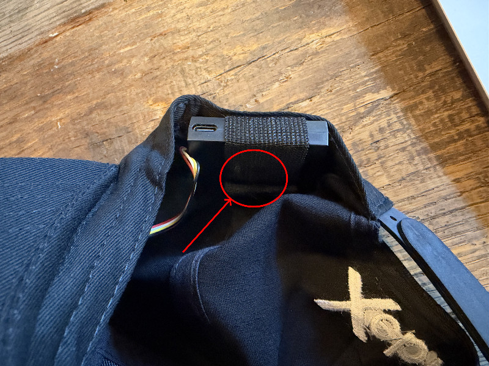
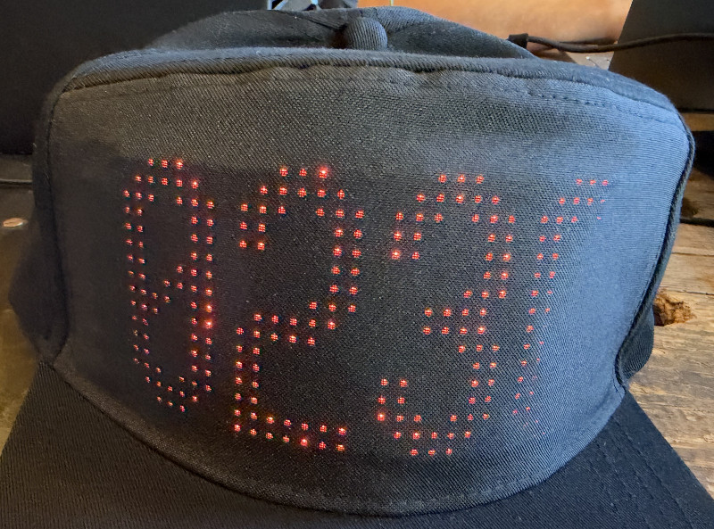

# Led Hat

This is the Xebia Led hat used/introduced at GitHub Universe 2026.

## Getting started

> [!IMPORTANT]
> Ensure the cap is fully charged the day before use!!

> [!IMPORTANT]
> Do not use the app that comes with the cap. You don't need it and it is of Chinese origin.

1. If you have an iPhone, install the [Bluefy app](https://apps.apple.com/us/app/bluefy-web-ble-browser/id1492822055).
2. The cap is bluetooth-controlled and needs to be switched on by keeping the push-button pressed.

3. When the cap is switched on, after the battery state is displayed, the unique Bluetooth name (4 character hex code) of the cap will be visible for pairing. If you missed it and the cap shows "WELCOME", turn it off and on again to see the Bluetooth name.

4. If you have an Android device, you'll need it to allow bluetooth access in order to pair with the cap.
5. In the browser (Bluefy browser for iPhone), navigate to https://rhsplinter.github.io/iledcolor-app.
6. On **LED Hat Connection**, press **Connect LED hat**, select the cap name from step 2, and pair. The controller opens after connection. You can also choose **Go to LED Hat Controller** to scan without a hat.
7. Open **Custom**, expand the content section you want, and use its **Send to cap** button to apply your changes.
   Keep the LED Hat Connection tab open. Refreshing the controller reattaches to that live link. If the link is gone, Scan stays available and Custom shows **Connect hat** to return to the connection screen. Explicit **Disconnect** in the top connection status releases the link and clears the remembered hat.
8. Familiarize yourself with the controls in the app and ask questions if you don't understand it. We have loaded the app with some presets you can use.

## Connect the hat or use the scanner

The website opens on **LED Hat Connection**, with **Connect LED hat**, **Go to LED Hat Controller**, and **Install app**. This tab explains that it holds the Bluetooth link and must stay open while using a connected hat.

- **Connect LED hat** opens the browser's device picker from that click. After pairing, the controller opens with **Presets** selected and receives focus. The connection tab stays open in the background.
- **Go to LED Hat Controller** opens **Scan** immediately without attempting to pair or reconnect from an old saved device. Badge scanning works without a hat; results stay in the controller and nothing is sent to a hat.
- The browser controller has five tabs: **Presets**, **Custom**, **Sound**, **Scan**, **Settings**. Custom uses the drawing/pencil icon. Without a hat, Presets, Sound, and Settings stay visible but disabled. Scan works and Custom provides Connect hat.
- On Custom, **Connect hat** opens or focuses the connection tab. The picker runs only there. When the hat connects, the controller automatically selects Presets.
- **Return to LED Hat Controller** focuses the existing controller without reloading it, or opens a replacement if it was closed.
- Go/Return and Connect hat use normal named-tab links. If the browser blocks the automatic controller opening after pairing, use Return; the hat remains connected and no second pairing is needed.
- Refreshing the controller reattaches only to a live connection tab. It does not call the device picker or use experimental saved-device APIs. If the connection is gone or reattachment fails, Scan remains available and Custom shows Connect hat.
- Disconnect releases the held link and forgets the saved hat. Closing or refreshing the connection tab also ends the Bluetooth link.

No experimental browser flags are needed. Install app is the third action and supports desktop and mobile browsers that offer installation. If the browser has not supplied an install prompt, the button explains the browser menu option. The connection page remains open while the controller runs in another tab or window. Native Android/iOS builds continue to use their native Bluetooth connection and retain Approach mode.

## Custom content and backups

The **Custom** tab contains the hat controls. **Text**, **Solid color**, **Image** and
**GitHub Contributions** each start collapsed; a right-pointing chevron expands a
section and turns down while it is open. Text scrolls automatically when it is wider than the cap,
supports emoji, and has its own font choice (or the Settings default). Images support
PNG, JPG and animated GIF, with contain, cover and stretch fitting.
The existing **Sequence** editor is available in its own collapsed section.

Each section has **Send to cap** and **Save as preset** controls. To save, enter a name
and select the adjacent check button. In **Presets**, each saved or built-in preset is a
full-width button with a type icon before its name. Tap it to send immediately to the
connected cap without leaving Presets or changing Custom editor drafts. Send progress
and errors appear on Presets; sending is disabled while the cap is unavailable or busy.
Share and Delete remain separate actions. Group presets apply Approach content without
leaving Presets and update caps when Approach is running (native app or mock mode only).
GitHub presets
store the handle, captions, caption font and their own scroll speed. When the graph was loaded before
saving, the preset also keeps that graph and its date, so it can be shown, used in
sequences and shared without internet; load the graph again to refresh it. Presets
saved before loading a graph fetch a fresh graph each time they are shown, which
requires internet and sends that public handle to the contribution service.

**Presets > Backup > Creations** includes saved presets, all current Custom editor
drafts (even collapsed sections and image fit/background before choosing a file),
per-text fonts, sequences, and GitHub handle, captions, caption font and speed. Selecting all
categories backs up portable configuration across all tabs. Imports are saved
atomically, refresh the UI immediately, and survive reload. Excluded categories and
newer preferences absent from version-1 or older version-2 files are preserved.
Expansion state is not saved: sections always start collapsed.

Phone identity, cap connections/device IDs, permissions, running state, QR payloads,
and scan-log contents are not exported. The scan-logging preference belongs to
**Scan settings**; importing it can enable local scan logging.

## More docs

Go to:

* [README.md](docs/README.md)
* [INSTALL.md](docs/INSTALL.md)
